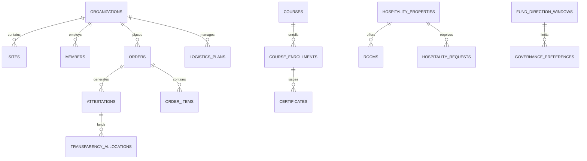

# Architettura e Schemi Dati per il Modello NoSQL/Firestore

Questo documento mappa tutte le entità e i contratti dei servizi digitali (C01–C16, Aree 1–5) nel modello di collezioni e documenti orientato a **Firestore / Database Locale Documentale**.

---

## 1. Struttura delle Collezioni Principali (Root Collections)

Nel database locale/Firestore, ogni entità è memorizzata in collezioni dedicate di documenti JSON con ID univoco:

---

## 2. Dizionario delle Collezioni e Schemi Documentali

### 2.1 Area 1 — Compliance ESG & Catena di Fornitura
- **`scope_datasets`** (Scope 3 LCA Data Hub - C01):
  - `id`: string (es. `DS-ECO-2026-21`)
  - `productModel`: string
  - `lot`: string
  - `version`: string
  - `status`: `'VERIFIED' | 'SUPERSEDED'`
  - `unit`: string (es. `'1 paio di calzature'`)
  - `carbonFootprintKg`: number
  - `conventionalFootprintKg`: number
  - `avoidedKg`: number
  - `factors`: array di `{ stage: string, kgCo2e: number }`
  - `contentHash`: string
  - `updatedAt`: timestamp ISO

- **`orders`** (Ordini & Forniture - C02, C12):
  - `id`: string (es. `ORD-DEMO-0142` o `BULK-...`)
  - `organizationId`: string (ref `organizations`)
  - `siteId`: string (ref `sites`)
  - `pairs`: integer (numero paia totale)
  - `totalCents`: integer (centesimi interi per precisione monetaria)
  - `devolutionRate`: integer (30% per modello EaaS)
  - `status`: `'SUBMITTED' | 'CONFIRMED' | 'RECTIFIED' | 'CANCELLED'`
  - `items`: array di `{ productId, size, quantity, unitPriceCents, totalCents }`
  - `confirmedAt`: timestamp ISO
  - `events`: array di `{ at, actor, event }`

- **`attestations`** (Attestazione Fondo & Audit Trail - C02):
  - `id`: string (es. `ATT-DEMO-0142`)
  - `orderId`: string (ref `orders`)
  - `pairs`: integer
  - `totalCents`: integer
  - `fundCents`: integer (quota 30% destinata al Fondo)
  - `status`: `'VERIFIED' | 'PENDING_REVIEW'`
  - `publicToken`: string (token casuale minimizzato per consultazione pubblica `/verifica/fondo/:token`)
  - `transferReference`: string (riferimento mascherato, es. `'Bonifico •••• 4521'`)
  - `auditTrail`: array di `{ at, actor, event }`

- **`evidence_documents`** (Evidenze documentali probatorie - C04):
  - `id`: string (es. `EV-LCA-001`, `EV-BANK-0142`)
  - `type`: `'LCA_DATASET' | 'BANK_RECEIPT' | 'AUDIT_TRAIL' | 'EMISSION_FACTORS' | 'SOCIAL_REPORT' | 'PROCUREMENT_POLICY' | 'CPT_STATEMENT' | 'MANAGEMENT_REPRESENTATION'`
  - `title`: string
  - `status`: `'VERIFIED' | 'DRAFT'`
  - `sourceId`: string (ref orderId, datasetId, ecc.)
  - `version`: string

- **`reports`** (Report di Impatto - C03):
  - `id`: string (es. `REP-DEMO-001`)
  - `template`: `'AREA_SISMA' | 'CANTIERE_INTEGRATO' | 'CPT' | 'STAKEHOLDER_SUMMARY'`
  - `siteId`: string | null
  - `period`: `{ from: string, to: string }`
  - `narrative`: string
  - `evidenceIds`: array di string (ref `evidence_documents`)
  - `status`: `'DRAFT' | 'VERIFIED' | 'PUBLISHED'`
  - `metrics`: `{ pairs, totalCents, fundCents, interventions, orderIds, organizationIds }`

- **`packs`** (Fascicoli Banca & Assurance - C04):
  - `id`: string (es. `PACK-BANK-001`, `PACK-ASSUR-001`)
  - `type`: `'BANK' | 'ASSURANCE'`
  - `title`: string
  - `status`: `'DRAFT' | 'VERIFIED'`
  - `items`: array di `{ id, label, evidenceId, required: boolean }`

---

### 2.2 Area 2 — Relazioni di Filiera & Editoriale
- **`brand_assets`** & **`brand_text_versions`** (C05):
  - Asset loghi (SVG/PNG validati), versioni testuali approvate e generazioni composite.
- **`editorial_contents`** (CMS Editoriale - C06):
  - `id`: string, `type`: `'CASE_HISTORY' | 'BEST_PRACTICE'`, `slug`: string (indicizzabile), `title`: string
  - `sections`: array di `{ heading, text }`
  - `linkedData`: `{ siteId, datasetId, attestationId, reportId }`
  - `status`: `'DRAFT' | 'PUBLISHED'`, `factualApprovedVersion`: integer
- **`partner_entries`** (Registro Partner della Ricostruzione - C07):
  - `id`, `publicSlug`, `organizationName`, `consentToPublish`: boolean, `municipalities`: array, `projects`: array

---

### 2.3 Area 3 — Welfare & Operatività
- **`hospitality_properties`** & **`hospitality_requests`** (C08):
  - Strutture convenzionate con elenco camere, tariffe in centesimi, disponibilità (stale dopo 72h).
  - Richieste di soggiorno con `requestKey` idempotente, stato `REQUESTED | CONFIRMED | CANCELLED`.
- **`courses`**, **`course_enrollments`**, **`certificates`** (C09):
  - Capitoli con video, trascrizione e quiz intermedi.
  - Verifica completamento non basata solo sul video: richiede esito test >= passScore (80%).
  - Attestato con `publicToken` e visualizzazione pubblica anonimizzata.

---

### 2.4 Area 4 — Governance & Board
- **`governance_members`** & **`governance_sessions`** (C10, C11):
  - Ruoli: `BOARD`, `STARTUP_REVIEWER`, `ESG_MANAGER`, con flag MFA.
- **`fund_direction_windows`** & **`fund_direction_options`** & **`governance_preferences`** (C10):
  - Finestre con `opensAt` e `cutoffAt` rigido lato server.
  - Preferenze espresse vincolanti, immutabili dopo il cutoff.
- **`briefing_sessions`** (C11):
  - Sessione Board riservata di 120 minuti, agenda, presenze effettive e pre-read.

---

### 2.5 Area 5 — Operazioni Digitali & Piattaforma
- **`operations_members`** & **`operations_sessions`** (RBAC multi-tenant):
  - Ruoli: `PROCUREMENT`, `HR_WELFARE`, `BOARD`, `SITE_MANAGER`, `SUBCONTRACTOR`, `STARTUP_REVIEWER`.
- **`product_catalog`** (C12):
  - Prodotti, SKU, listini contrattuali in centesimi e stock taglie.
- **`service_entitlements`** (C13):
  - Mappatura diritti per organizzazione: standard vs varianti, soglie coppie (10, 25, 50, 100), attivazioni.
- **`transparency_projects`** (C14):
  - Opere nei borghi con allocazioni pubbliche collegate ad attestazioni e rettifiche storiche.
- **`logistics_plans`** (C15):
  - Fabbisogni taglie per cantiere, finestre di consegna, riconciliazione ordini/spedizioni.
- **`subcontractor_links`** (C16):
  - Accordi quadro con subappaltatori: verifica Partita IVA, consensi, doppia attribuzione ordini.
